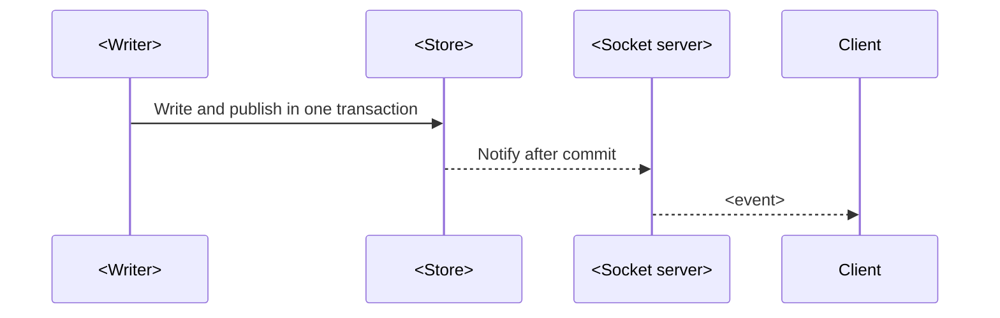

# Realtime events

## Overview

<!-- The single catalogue of events. Every other document links to an event here and does not
list events itself. -->

Clients receive events over <transport>. This document owns the list of events, their payloads,
who publishes them and who receives them. It also owns what a client must do after a reconnect.

## Delivery

<!-- How an event goes from a write to the clients. A sequence diagram with the real
participants. State the guarantees: ordering, at-most-once or at-least-once, after-commit. -->

| No. | Guarantee | Value |
|---|---|---|
| 1 | Order | <per room, none, …> |
| 2 | Delivery | <at most once. The client resyncs after a reconnect.> |

## Event catalogue

<!-- One row per event. Keep payload in a short form; link to the schema if it is long. -->

| No. | Event | Payload | Published by | Recipients | Published when |
|---|---|---|---|---|---|
| 1 | `<name>` | `{ <fields> }` | <component> | <who> | <One condition.> |

## Client obligations

| No. | Situation | Client action |
|---|---|---|
| 1 | Reconnect | <Call the resync route, then …> |
| 2 | Unknown event | <Ignore it.> |

## Subscription limits

| No. | Limit | Value | Effect when reached |
|---|---|---|---|
| 1 | <subscriptions per connection> | <n> | <…> |

## Decisions

- **D1. <Decision.>** <Why.> Rejected: <option, reason>.

## Limits and open questions

- <Item.> Status: <accepted limit | open>.

## Related documents

- [<Document>](<path>): <why>.
