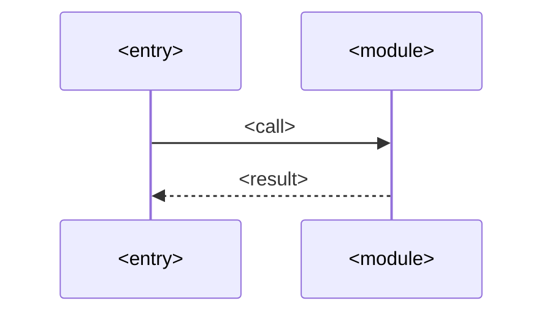

# <Application or module> internals

## Overview

<!-- At most 5 sentences: what this deployable or module does, and the one rule that organizes
its inside (for example "folders are grouped by the external system they speak to"). -->

<Component> <does what>. Its inside is organized by <rule>. Behavior is described in other
documents. This document owns the structure, the dependency direction and how both are enforced.

## Responsibilities

| No. | Does | Does not (owner) |
|---|---|---|
| 1 | <responsibility> | <responsibility> ([<owner>](<path>)) |

## Structure

<!-- Folders, not files. One line each. Files change often and rot this table. -->

| No. | Folder | Responsibility | May depend on |
|---|---|---|---|
| 1 | `<folder>/` | <One sentence.> | `<folder>/`, `<package>` |

## Dependencies

<!-- A dependency map. Draw with the technical-diagrams skill (draw.io for more than ~8 nodes). -->

| No. | Rule | Why |
|---|---|---|
| 1 | `<a>/` never imports `<b>/` | <One sentence.> |

## Main flow

<!-- The sequence of one typical unit of work through the component. -->

## Lifecycle

| No. | Phase | What happens |
|---|---|---|
| 1 | Startup | <validation, connections> |
| 2 | Shutdown | <drain, timeout> |

## Error handling

| No. | Error | Handled by | Result |
|---|---|---|---|
| 1 | <kind> | <layer> | <response, retry, crash> |

## Enforcement

| No. | Rule | Check | Catches |
|---|---|---|---|
| 1 | <dependency rule> | <lint rule, test> | <what a violation looks like> |

## Decisions

- **D1. <Decision.>** <Why.> Rejected: <option, reason>.

## Limits and open questions

<!-- Include what the checks do not cover. -->

- <Item.> Status: <accepted limit | open>.

## Related documents

- [<Document>](<path>): <why>.
