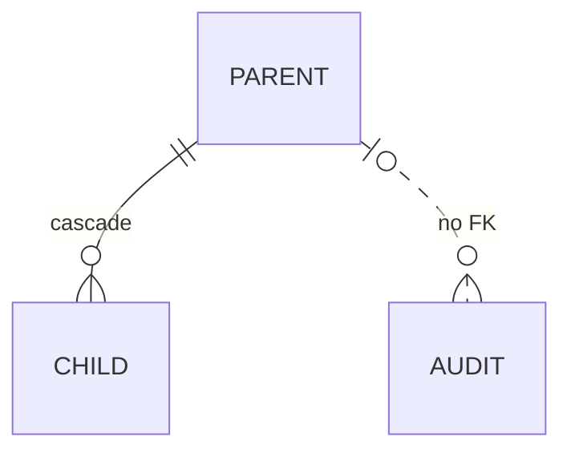

# Data model

## Overview

<!-- At most 5 sentences: which store, what it holds, what it does not hold, and a reading
guide ("for X, read section Y"). -->

<Store> holds <what>. Data owned by other systems stays there and is read through
[<integrations>](../integrations/). This document owns the tables, their keys and constraints.
The workflows that change a row's status are in [<Workflow>](../workflows/<process>.md).

## Storage boundary

| No. | Data | Owner | Access |
|---|---|---|---|
| 1 | <rooms, messages> | This database | <ORM or query layer> |
| 2 | <employees> | <external system> | [<Adapter>](../integrations/<system>.md) |

## Entity relationships

<!-- An ER diagram with relationships only. The columns are in the Entities section, so they
have one owner. Use a dashed edge for a relationship that is not a foreign key. -->

| No. | Edge that is not a foreign key | Reason |
|---|---|---|
| 1 | <parent> to <child> | <One sentence.> |

## Entities

<!-- One ### section per table, in the order a reader meets them. Each section has exactly
three parts, in this order: bullet points that explain the table (one fact each, STE: short
sentences, active voice), the column definition table, and the table's own indexes and
constraints. Do not write paragraphs here, and do not collect indexes in a separate section.
One database column per row: never group columns ("six source_* columns") in one row.
Give the exact database type. PK: "Yes" or empty. FK: the referenced `table.column` and the
delete rule. Note: one fact. A longer rule about a column goes in a bullet above the table. -->

### `<table>`

- One row: <what one row represents>.
- Rows: <how many per parent, for example one per room and document type>.
- Written by: <component>, when <condition>.
- Deleted when: <event, for example the room is deleted (cascade)>.
- <Other fact about the whole table, one line.>

| No. | Column | Data type | PK | FK | Nullable | Default | Note |
|---|---|---|---|---|---|---|---|
| 1 | `id` | `uuid` | Yes | | No | <default expression> | |
| 2 | `<parent>_id` | `uuid` | | `<parent>.id`, on delete cascade | No | | <One fact.> |
| 3 | `<column>` | `<varchar(8)>` | | | <Yes \| No> | <value or empty> | <One fact.> |

| No. | Index or constraint | Type | Columns | Rule |
|---|---|---|---|---|
| 1 | `<name>` | <unique \| check \| index> | `<a>`, `<b>` | <One sentence: what it guarantees or speeds up.> |

## Derived state

<!-- Values computed from rows and never stored. Say where each one is computed. -->

| No. | State | Derived from | Computed by |
|---|---|---|---|
| 1 | <lock state> | <rows and columns> | <component> |

## Retention and deletion

| No. | Data | Deleted when | Deleted by |
|---|---|---|---|
| 1 | <room and its children> | <room deletion> | <cascade> |

## Migrations

<!-- The policy, not the history: how a migration runs, and rules for backfills. -->

- <Rule.>

## Decisions

- **D1. <Decision.>** <Why.> Rejected: <option, reason>.

## Limits and open questions

<!-- Unused columns and tables go here, one line each, with the action that removes them. -->

- <Item.> Status: <accepted limit | open>.

## Related documents

- [<Document>](<path>): <why>.
