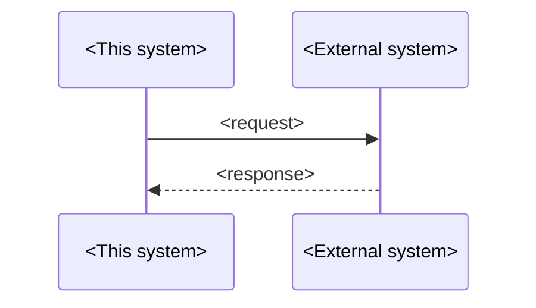

# <External system> integration

## Overview

<!-- At most 5 sentences: what the external system is, who owns it, what this system uses it
for, and through which port. -->

<External system> is <what>, owned by <team or vendor>. This system uses it to <purpose>. All
calls use the <port> port. This document owns the calls, the field mapping and the
failure handling.

## System facts

<!-- Mark the source of each fact. An assumption that looks like a fact causes outages. -->

| No. | Fact | Value | Source |
|---|---|---|---|
| 1 | Protocol | <REST, MySQL, …> | <documented, observed on date, assumed> |
| 2 | Authentication | <…> | <…> |
| 3 | Environments | <…> | <…> |

## Port

| No. | Operation | Input | Output | Errors |
|---|---|---|---|---|
| 1 | `<operation>` | <fields> | <fields or result union> | <named errors> |

## Calls

<!-- One sequence diagram per operation that has more than one call or a branch. -->

## Data mapping

| No. | This system | External field | Transform | Rule |
|---|---|---|---|---|
| 1 | `<field>` | `<FIELD>` | <format, code table> | <One rule.> |

## Failure handling

| No. | Failure | Detection | Retry | Duplicate protection | Result |
|---|---|---|---|---|---|
| 1 | <timeout> | <after N s> | <count, backoff> | <idempotency key, lock> | <state or error> |

## Test doubles

| No. | Environment | Implementation | Differences from the real system |
|---|---|---|---|
| 1 | <local> | <stand-in> | <One fact.> |

## Decisions

- **D1. <Decision.>** <Why.> Rejected: <option, reason>.

## Limits and open questions

- <Item.> Status: <accepted limit | open>.

## Related documents

- [<Document>](<path>): <why>.
