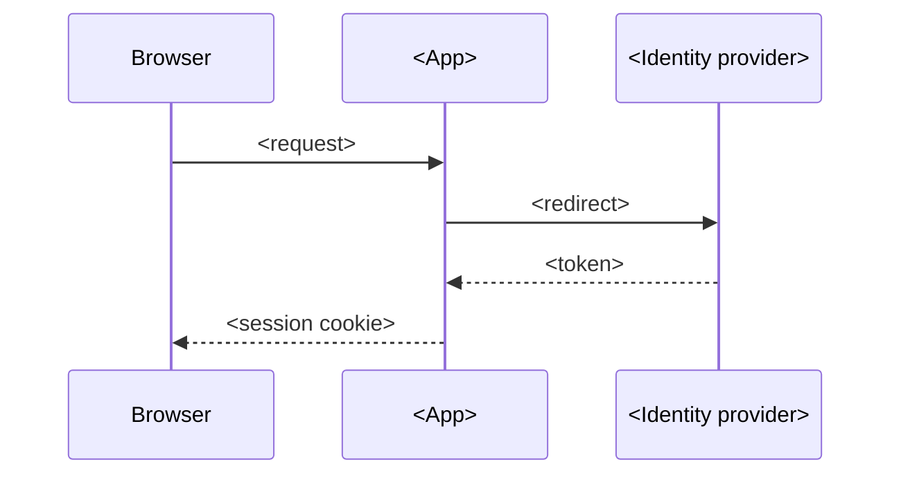

# Security

## Overview

<!-- At most 5 sentences: what is protected, how users are identified, and the main controls. -->

<The system> protects <assets>. Users sign in through <identity provider>. This document owns
identity, sessions, authorization rules and the threat list.

## Assets

| No. | Asset | Classification | Stored in |
|---|---|---|---|
| 1 | <personal data> | <confidential> | <store> |

## Trust boundaries

<!-- A diagram of the boundaries and the data that crosses each one. -->

## Identity

| No. | Identity form | Example | Where it is used |
|---|---|---|---|
| 1 | <employee number> | `<10000001>` | <session, database> |

## Authentication

## Sessions and credentials

| No. | Credential | Lifetime | Storage | Protection |
|---|---|---|---|---|
| 1 | <session cookie> | <time> | <where> | <HttpOnly, Secure, SameSite> |

## Authorization

| No. | Rule | Enforced at |
|---|---|---|
| 1 | <Only a member of a room can read it.> | <layer> |

## Threats and controls

| No. | Threat | Control | Status |
|---|---|---|---|
| 1 | <session theft> | <control> | <implemented, planned> |

## Accepted risks

| No. | Risk | Why it is accepted | Review when |
|---|---|---|---|
| 1 | <risk> | <One sentence.> | <trigger> |

## Decisions

- **D1. <Decision.>** <Why.> Rejected: <option, reason>.

## Limits and open questions

- <Item.> Status: <accepted limit | open>.

## Related documents

- [<Document>](<path>): <why>.
