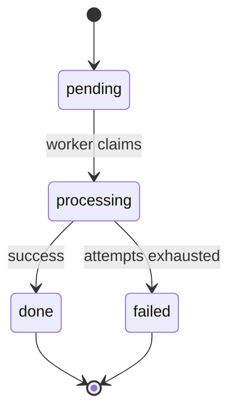

# <Process or lifecycle name>

## Overview

<!-- At most 5 sentences: which item moves through which states, who moves it, and how it ends.
Give the main path in one sentence. -->

A <item> moves from <first state> to <final state>. <Actors> move it. On the main path, <one
sentence>. The stored columns are in [Data model](../data/data-model.md#<table>).

## Actors

| No. | Actor | Can do |
|---|---|---|
| 1 | <member, agent, worker, operator> | <transitions or actions> |

## States

<!-- The state diagram first, then one row per state. Every state in the diagram has a row, and
every row is in the diagram. Mark terminal states. -->

| No. | State | Meaning | Effect while in this state |
|---|---|---|---|
| 1 | `<state>` | <One sentence.> | <What is locked, visible or blocked.> |

## Transitions

<!-- One row per arrow of the diagram. Guard: what must be true. Side effects: what is written or
published, and in which transaction. -->

| No. | From | Trigger | Guard | To | Side effects |
|---|---|---|---|---|---|
| 1 | `<state>` | <event or command> | <condition> | `<state>` | <writes, events> |

Every transition that is not in this table is refused.

## Invariants

<!-- Numbered so other sections and documents can refer to them by number and name. -->

1. **<Name>.** <Rule.>

## Concurrency and timing

<!-- Locks, leases, timeouts, retries, order. Delete if none. -->

| No. | Mechanism | Rule | Failure it prevents |
|---|---|---|---|
| 1 | <lease> | <One rule.> | <One sentence.> |

## Failures and recovery

| No. | Failure | Detected by | State after | Recovery |
|---|---|---|---|---|
| 1 | <worker dies> | <lease expiry> | `<state>` | <automatic: …, or [Runbook](../operations/runbooks/<task>.md)> |

## User-visible messages

<!-- Optional. What the user is told in each state that needs a message. -->

| No. | State | Message |
|---|---|---|
| 1 | `<state>` | <text or message key> |

## Decisions

- **D1. <Decision.>** <Why.> Rejected: <option, reason>.

## Limits and open questions

- <Item.> Status: <accepted limit | open>.

## Related documents

- [<Document>](<path>): <why>.
