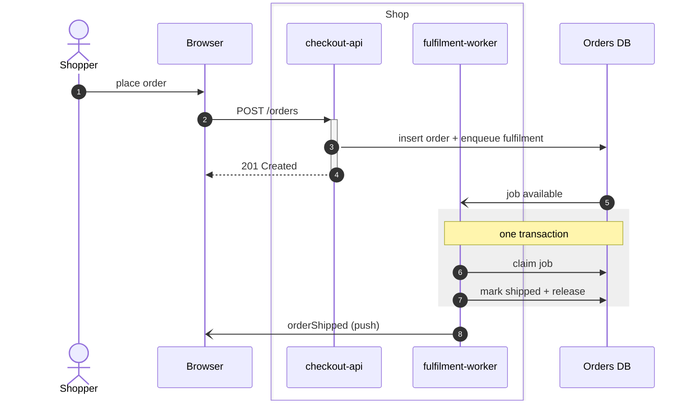
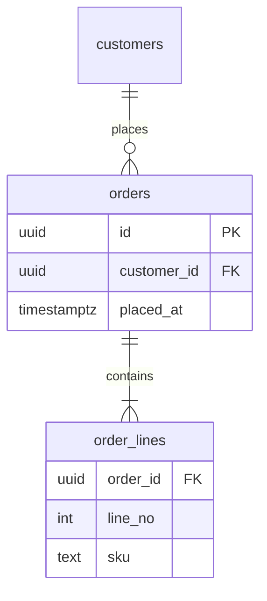
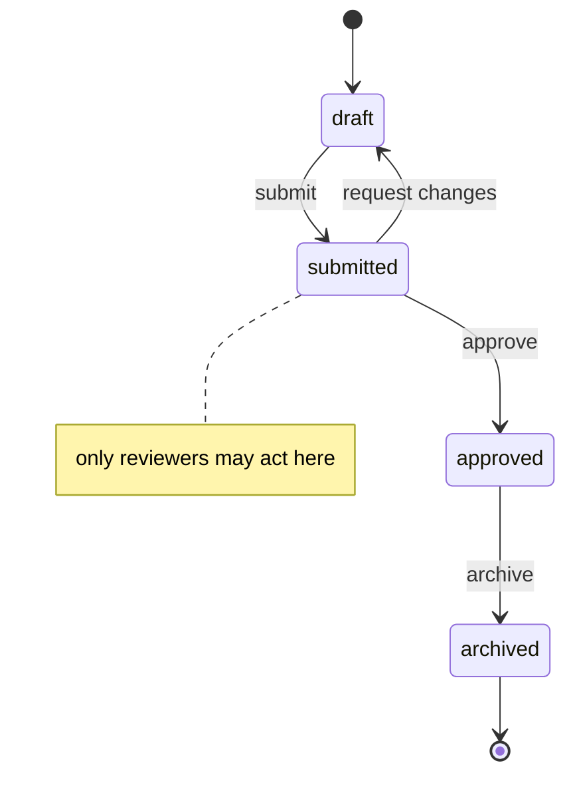

# Mermaid conventions

GitHub, GitLab and most markdown viewers render fenced ```` ```mermaid ```` blocks and theme them
for light and dark mode themselves. Most Mermaid ugliness comes from fighting that theming, or
from syntax that renders differently than intended.

## Rules for every diagram type

- **No colours or themes.** No `%%{init: ...}%%` theme variables, and no `style`, `classDef` or
  `linkStyle` fills. The viewer picks the colours per theme, and a hard-coded fill becomes
  unreadable in one of the two themes. The exception is a sequence `rect` with a translucent colour (below).
- **Short text.** Long messages and notes stretch the diagram sideways. Keep them to a phrase, and
  put the explanation in the prose.
- **Literal text.** Mermaid does not render markdown backticks. `api` reads better than
  `` `api` ``.
- **Escapes.** `;` ends a statement in a sequence message; write `#59;`. Use `#35;` for `#` and
  `<br/>` for a forced line break. Quote labels that contain `()`, `[]`, `{}` or `:`.
- **Names.** Use the same component names as the rest of the document and the code.

## sequenceDiagram



- Declare participants in left-to-right order of first use, with short aliases
  (`participant API as api`). Use `actor` for people.
- Arrows: `->>` request or call, `-->>` response, `-)` async message (fire-and-forget, event, push).
- `+`/`-` activation bars only where the reader needs to see who is busy, not on every call.
- `alt` / `else` for exclusive outcomes, `opt` for optional, `loop` for repetition, `par` / `and`
  for concurrency, `break` for an early exit, `critical` for an all-or-nothing section.
- `box Name ... end` groups participants that share a boundary. Leave out a colour, or the box
  breaks in dark mode.
- `rect rgba(127, 127, 127, 0.12)` highlights a span in both themes. Never use an opaque `rgb()`.
- `autonumber` when the prose refers to steps by number.
- `Note over A,B:` states an invariant or a transaction boundary.
- Too wide (more than about 7 participants) or too long (more than about 25 messages)? Split it by
  phase ("sign-in", "first request") rather than shrinking the text.

## erDiagram



- Entity names are the table names. Attributes are `type name PK|FK|UK "comment"`, and
  `customers` without a column list stays legible.
- Cardinality: `||` exactly one, `o|` zero or one, `}|` one or more, `}o` zero or more. The label is
  a verb read left to right.
- Show only the columns the section discusses. The schema is the source of truth for the rest.

## stateDiagram-v2



- States are the values the code stores. Transition labels are `event` or `event / guard`.
- Use one `[*]` start. A terminal state points at `[*]`.
- A composite state (`state processing { ... }`) holds sub-states only when the parent state has
  real sub-states in the code.

## Flowcharts

Do not write flowcharts in Mermaid, also not small ones. Its layout crosses edges and stretches
labels, and readers found even small ones hard to read. Draw every flowchart in draw.io.
