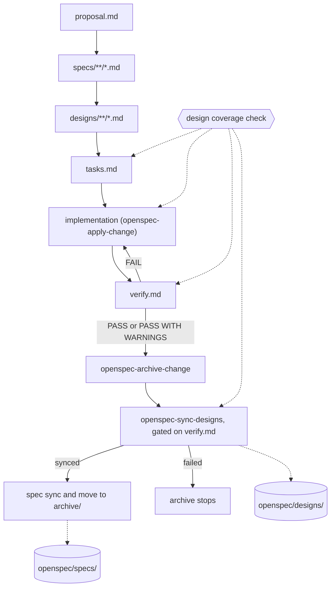

# super-sdd

A custom OpenSpec workflow with adaptive design documents, durable design sync, and evidence gates.
Version 1.14.3.15: revision 15, checked against OpenSpec CLI 1.14.3 and compatible with 1.14.x.



`openspec-continue-change` creates the next artifact; `openspec-propose` prepares implementation
prerequisites. The design artifact is a set of files rather than a fixed document list, which is why
the coverage check hangs off four points: OpenSpec marks `designs/**/*.md` done as soon as one
matching file exists, so it can never tell you the set is complete. The check is agent-enforced, not
CLI validation, and it stops the next phase on missing or unlisted files, unfinished content, broken
design links, or conflicting destinations.

Apply reads every design file and tracks tasks.md. The schema owns every workflow rule; the only
thing `openspec/config.yaml` adds is one `operations.archive.guidance` entry that makes
`openspec-archive-change` run `openspec-sync-designs` before it syncs specs and moves the change.
The sync skill also runs on its own when explicitly requested.

Two rules the arrows understate. The sync skill refuses to write unless verify.md holds a passing
`Decision:` line, and you never archive after a failed or incomplete sync, because OpenSpec's own
archive does not merge designs.

## Install

Prerequisites: OpenSpec CLI 1.14.x, plus the Superpowers skills for brainstorming, writing plans,
subagent-driven development, and verification. Those four are binding, so the relevant phase stops if
its skill is unavailable. Companion skills support TDD, worktrees, review, and debugging.

The schema and the sync skill also depend on two documentation skills, which super-sdd ships and
installs:

- `design-docs`: the per-kind template, writing rules, and `ste-lint` that the design phase and the
  sync skill apply to every durable document.
- `technical-diagrams`: Mermaid only for sequence, ER, and state diagrams; an editable `.drawio.svg`
  in a `diagrams/` folder beside the document for every flowchart, architecture, topology, and
  dependency map.

Their scripts need Node 20 or newer and git.

```toml
[tools]
"github:rayjp2010/super-sdd" = "1.14.3.15"
"npm:@fission-ai/openspec" = "1.14.3"
```

```bash
mise install
openspec init          # OpenSpec's own setup; skip if the project has openspec/
super-sdd install
```

Setting OpenSpec up is OpenSpec's business, so `super-sdd install` does not pin the CLI, run `init`,
or generate skills. It installs super-sdd into a project that already has `openspec/`, and stops with
a message if that directory is missing. It warns, without blocking, when the CLI it finds is outside
the series this revision targets.

That leaves the project holding:

```
your-project/
  openspec/config.yaml                     replaced only when untouched since openspec init
  openspec/schemas/super-sdd/              schema.yaml and the five templates
  .agents/skills/openspec-sync-designs/    the project's one copy of the sync skill
  .agents/skills/design-docs/              design writing templates, rules, and ste-lint
  .agents/skills/technical-diagrams/       diagram rules and the draw.io render-and-lint script
  .claude/skills/<each skill above>        symlinks, when the project has a .claude directory
```

The mirror is keyed on `.claude` existing rather than `.claude/skills`, since a Claude project can
predate that subdirectory. A config.yaml carrying real project settings is left alone, and you add
the `operations.archive.guidance` entry yourself. Nothing else is overwritten without `--force`, which
is also how you re-run the installer after `mise up`. The installer checks every destination before
its first write, so a refusal leaves the project unchanged. Without mise, run `bin/super-sdd install` from
a clone.

Use the CLI-generated OpenSpec skills rather than copying their implementations from another project,
and run everything from the project root. Outside a project that pins the CLI, where mise may hold
openspec with no active version, use `mise exec npm:@fission-ai/openspec@1.14.3 -- openspec ...`
instead of changing global settings.

```bash
openspec schema validate super-sdd --verbose         # after installing
openspec templates --schema super-sdd
openspec new change <change-id> --schema super-sdd

openspec status --change <change-id> --json          # inspecting a change in flight
openspec instructions design --change <change-id> --json
openspec instructions apply --change <change-id> --json
openspec validate <change-id> --type change --strict --json
```

## Versioning

Releases are `<openspec-version>.<super-sdd-revision>`: the OpenSpec CLI version this workflow was
checked against, then the workflow's own revision. `1.14.3.15` is revision 15 checked against OpenSpec
1.14.3, and the next revision is 1.14.3.16. Checking against a newer OpenSpec release moves the first
three fields while the revision carries on, as 1.11.0.14 became 1.14.3.15. Shorter pins take the
newest release under that prefix, so `= "1.14.3"` follows revisions for that OpenSpec release and
`= "1.14"` follows the series.

`VERSION` is the source of truth: four numeric fields, last field equal to `version:` in
`openspec/schemas/super-sdd/schema.yaml`, tag equal to `v$(cat VERSION)`. The release workflow
refuses to publish otherwise, then attaches a `git archive` tarball to a GitHub release.

## Adaptive designs

The proposal's Design Documents table inventories change-local paths, purposes, and durable targets,
and that inventory is the coverage contract. Pick the smallest useful set. These are examples, not
presets:

| Change | Possible change-local documents |
|---|---|
| Small refactor or docs change | designs/overview.md |
| Web checkout change | designs/checkout-ui.md, designs/payment-api.md |
| Batch ingestion change | designs/ingestion.md, designs/recovery.md |
| Multiple applications | designs/web/session.md, designs/api/authorization.md |

Every document uses the same small template. `CONTEXT` holds change-local decisions and alternatives.
`Durable Design: openspec/designs/<target>` sections carry the ADDED/MODIFIED/REMOVED content that
sync merges before archive. One document may own several destinations, but a destination has exactly
one owner per change, so cross-reference related documents instead of repeating decisions, and update
the inventory when the split changes. A document with no durable destination keeps brief context plus
the explicit `No durable design impact.` line.

Paths inside a change start from the CLI-reported `changeRoot`. Durable targets start from
`planningHome.root` and stay inside its `openspec/designs/` tree; archive paths start from
`planningHome.changesDir`. Use `artifactPaths.design.existingOutputPaths` for discovery, and read
every path in apply `contextFiles`.

## Upgrade existing projects

Bump the pin in `mise.toml`, then run `mise install && super-sdd install --force`. That replaces the
schema and the three skills together, and drops the old `templates/archive.md`. Merge revised config
guidance by hand, since an edited `openspec/config.yaml` is never overwritten. The revision number is
informational and does not pin older changes to an older copy of the schema.

From revision 14 or earlier:

1. In `openspec/config.yaml`, delete the super-sdd rules from `context` and the whole
   `operations.apply` block; the schema now carries them. Replace `operations.archive.guidance` with
   the single entry from this repository's `openspec/config.yaml`. Keep only project facts in
   `context`.
2. Delete any prepared `archive.md` in active changes. Revision 15 has no archive artifact; the
   verify.md gate moved into the sync skill.
3. `super-sdd install --force` now also installs `design-docs` and `technical-diagrams`, and
   replaces any copy the project already has. If the project has edited its own copy, diff it
   against the shipped one first and carry the edits back afterward.

The sync skill no longer reads a legacy single `design.md`. Before upgrading, migrate each active
legacy change:

1. Resolve `changeRoot` through status JSON. Move its design.md to designs/overview.md inside that
   root, preserving all context and durable delta sections. Split it further only when useful.
2. Replace Durable Design Impact in the proposal with Design Documents, listing every local document
   and its destinations. Use `none` for an explicit no-impact document.
3. Update design links in tasks and other artifacts, then re-run coverage and verification.

Leave archived changes untouched; sync never runs on them.

## Maintaining the schema

Templates define document structure and schema instructions define workflow rules. Project `context`
is injected into artifact instructions, `rules` adds per-artifact guidance, and `operations` supplies
apply and archive guidance. Keep super-sdd's own rules in the schema, so an adopting project's
`context` holds only its own facts. The schema has no shared-context field, so the shared rules
repeat in each artifact instruction. Unknown schema keys are silently stripped, so do not invent
fields for gates, and check rendered instructions as well as schema validation.

Three CLI behaviors shape the design, all checked against 1.14.3:

- `instructions archive` is a reserved operation command that returns operation inputs, never an
  artifact's instruction or template. So the schema has no archive artifact, and the one
  `operations.archive.guidance` entry in config.yaml is what runs the sync skill before archive.
- Apply's `all_done` response replaces the schema's apply instruction with a generic "review or
  verify" line. The sync skill's verify.md gate is what keeps an unverified change from archiving.
- 1.14 entity-escapes `<word>` placeholders that look like instruction-envelope tags, such as
  `<artifact>` and `<path>`. Use names like `<file-path>` in templates and instructions.

See the official
[schema reference](https://openspec.dev/docs/schemas/schema-yaml),
[customization guide](https://openspec.dev/docs/customize-schemas), and
[configuration reference](https://openspec.dev/docs/configuration/config-yaml).

Preserve these contracts when simplifying:

- Specs use capability directories, body-level SHALL/MUST, and level-4 Scenario headings. MODIFIED
  includes the full requirement and every scenario. New capabilities need a meaningful Purpose.
- No-spec changes set `skip_specs: true`; retiring a capability sets `retire_capabilities: true`.
- Only task checklists use checkboxes. Unique task IDs and removal Reason/Migration metadata are
  workflow conventions, not custom-schema CLI checks.
- Verify retains scope and commit prechecks and evidence decisions. Files existing does not mean
  those gates passed, and verify and archive happen after implementation, not during planning.

On CLI upgrades, check supported schema fields, glob output discovery, and generated apply and
archive instructions. `openspec update` refreshes generated skills but leaves this custom schema and
the three shipped skills alone, so revalidate the schema and all five templates afterward.

Every release raises `version:` in `schema.yaml` and the last field of `VERSION` together, including
a release that only touches the installer. Run `bash test/install_test.sh`, which checks that pairing
along with the installer's behavior.
